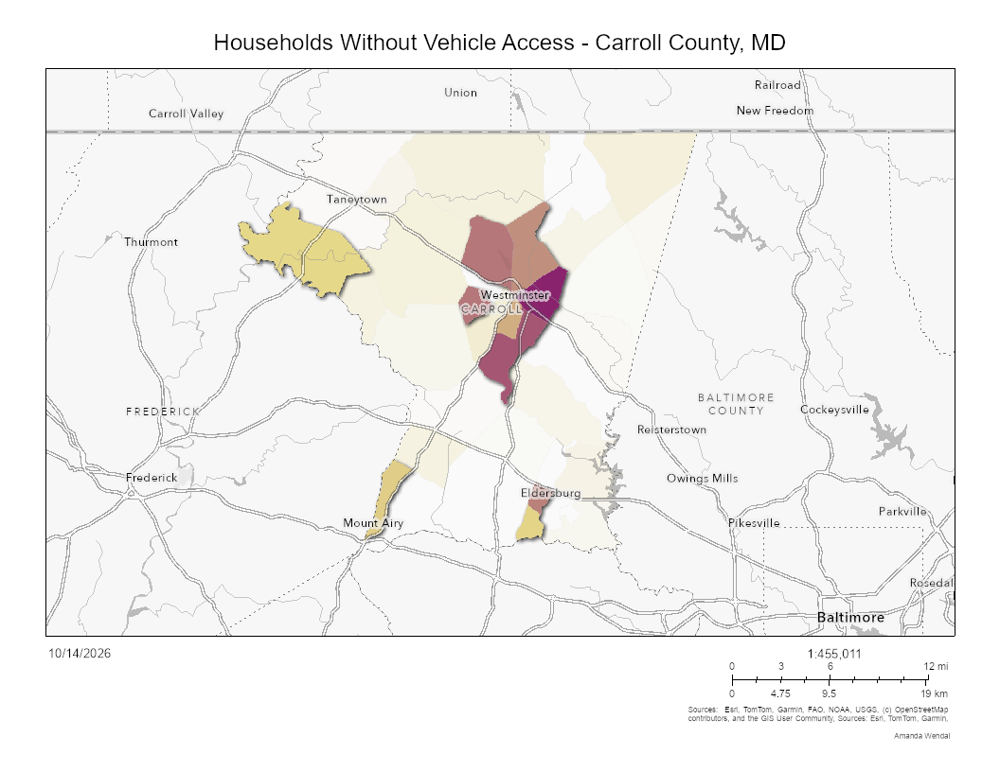

# Carroll County, MD: Households Without Vehicle Access

ArcGIS Online map showing the percentage of households without vehicle access by census tract in Carroll County, Maryland. During emergencies, maps like this can help identify areas where residents may need evacuation assistance.

## Purpose
Households without a vehicle may be unable to evacuate on their own during floods, severe storms, or other emergencies. Mapping where these households are concentrated can help emergency planners prioritize outreach, transportation assistance, and shelter planning.

## Key Findings
- The highest share of households without vehicle access is concentrated in and around Westminster.
- A smaller concentration appears near Eldersburg.
- Rural tracts in the northern and western parts of the county show low percentages, consistent with car dependence in rural areas.

## Data
- **Source:** ACS Vehicle Availability (Latest), Esri, ArcGIS Living Atlas of the World
- **Underlying data:** U.S. Census Bureau, American Community Survey (ACS) 2020–2024 5-year estimates, Table B08201 (Household Size by Vehicles Available)
- **Geography:** Census tracts, filtered to Carroll County, Maryland

## Tools
- ArcGIS Online (Map Viewer)

## Methods
1. Added the Living Atlas layer to a new web map in ArcGIS Online.
2. Filtered the nationwide tract-level layer to Carroll County, Maryland (County Name and State Name conditions).
3. Reviewed tract-level values in the attribute table and pop-ups.
4. Applied a feature effect to emphasize the 10 tracts with the highest percentage of households without vehicle access, while keeping the remaining tracts visible but muted for context.
5. Exported the final map as an image.

## Limitations
ACS figures are survey-based estimates with margins of error, which can be large for small areas like census tracts. Results should be treated as approximate indicators rather than exact counts.

## Live Map
[View the interactive map] https://arcg.is/1bn14H2

## Author
Amanda Wendal | [LinkedIn](https://www.linkedin.com/in/amandawendal)